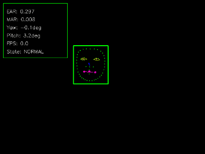

# Driver Monitoring System (DMS)

Real-time driver drowsiness, yawn and distraction detection from a single webcam, built on MediaPipe Face Landmarker (478 landmarks), OpenCV and a Streamlit analytics dashboard.



*Demo generated from one of the recorded sessions with `--privacy`: the camera image is replaced by black and only landmarks and the HUD are drawn. The state machine goes from normal to a DROWSY alert after the eyes stay closed for 1 s.*

## How it works

| Signal | Measure | Alert rule (defaults) |
|---|---|---|
| Drowsiness | Eye Aspect Ratio (EAR) of both eyes | EAR < 0.21 continuously for 1.0 s |
| Yawning | Mouth Aspect Ratio (MAR) from inner-lip points | MAR > 0.6 continuously for 2.0 s |
| Distraction | Head pose (solvePnP on 6 landmarks): yaw / pitch / roll | yaw > 30 deg, pitch > 20 deg or roll > 25 deg for 1.5 s |
| No driver | no face found | no face for 3.0 s |

Design points:

- **Time-based, not frame-based**: thresholds are in seconds, so behaviour does not depend on the camera frame rate. Video files are timed by frame index / fps.
- **No false alarms without a face**: with no face, fatigue trackers are reset (after 0.5 s) and only the "driver not detected" alert can fire, after 3 s.
- **Alert cooldown**: the highest-priority condition (drowsy > distracted > yawn > no driver) is announced; the same alert repeats at most every 5 s. Logged events are one per *episode* (flicker around a threshold is merged), not one per frame.
- **Per-driver calibration** (`--calibrate N`): for the first N seconds the driver looks at the road with eyes open; the EAR threshold becomes 0.72 x the driver's open-eye EAR (clamped to 0.12-0.30) and the neutral head pose is subtracted from yaw/pitch/roll (handy when the camera is not straight in front of you).
- **Audio degrades gracefully**: beeps use pygame on one background thread; if there is no audio device or pygame is missing it falls back to the terminal bell. Spoken warnings are optional (`pip install -r requirements-voice.txt`).
- **Model auto-download**: `models/face_landmarker.task` is downloaded on first run from the official MediaPipe storage bucket (atomic write, clear error if offline).

## Installation

Python 3.10+ (developed and tested on Python 3.12, macOS arm64).

```bash
git clone https://github.com/parvashah29/Driver-Monitoring-System.git
cd Driver-Monitoring-System
python3 -m venv venv && source venv/bin/activate
pip install -r requirements.txt
# optional: pip install -r requirements-voice.txt   (spoken warnings)
# optional: pip install -r requirements-dev.txt     (pytest)
```

The first run downloads the ~3.7 MB model. Offline? Download
`https://storage.googleapis.com/mediapipe-models/face_landmarker/face_landmarker/float16/1/face_landmarker.task`
into `models/` yourself.

## Usage

```bash
python main.py                                  # webcam, live window (q quit, d debug, r reset counters)
python main.py --calibrate 5                    # calibrate on the first 5 s
python main.py --video clip.mp4                 # analyse a file with a window
python main.py --video clip.mp4 --headless --report report.json   # no window/audio, JSON statistics
python main.py --video clip.mp4 --headless --save out.mp4          # write annotated video
python main.py --video clip.mp4 --headless --save out.mp4 --privacy  # black background, landmarks only
```

Options: `--camera N`, `--headless/--no-display`, `--save [PATH]`, `--privacy`, `--report PATH`, `--calibrate SECONDS`, `--fps F` (override wrong file metadata), `--max-frames N`, `--no-audio`, `--no-voice`, `--no-log`, `--debug`.

Session logs (`dms_session_*.log`, `events_*.json/csv`, `summary_*.json`) are written to `logs/` (git-ignored). If the camera cannot be opened, the program prints what to check (permissions, other apps, `--camera`) and exits.

### Dashboard

```bash
streamlit run src/dashboard/app.py
```

Overview, per-session analysis (event timeline, EAR/MAR of events) and the active thresholds, read from the logs in `logs/`.

### Configuration

All thresholds live in `src/utils/config.py` and can be overridden with environment variables, e.g. `DMS_EAR_THRESHOLD=0.19`, `DMS_CLOSED_SECONDS`, `DMS_MAR_THRESHOLD`, `DMS_YAWN_DURATION`, `DMS_YAW_THRESHOLD`, `DMS_PITCH_THRESHOLD`, `DMS_ROLL_THRESHOLD`, `DMS_DISTRACTION_SECONDS`, `DMS_ALERT_COOLDOWN`, `DMS_NO_FACE_SECONDS`, `DMS_LOGS_DIR`.

## Validation

There is no live webcam in the test environment, so the detection pipeline was validated **offline on four recorded sessions** (640x480, one driver, indoors; about 1500 frames each, headless, Apple-silicon CPU). These recordings are not included in the repository (they show a real person).

| Clip | Frames / seconds | Face found | EAR median (p5) | MAR p95 | Blinks | Drowsy / yawn / distraction / no-driver episodes |
|---|---|---|---|---|---|---|
| A | 1500 / 51 s | 89.1 % | 0.291 (0.196) | 0.63 | 7 | 1 / 0 / 1 / 0 |
| B | 1500 / 51 s | 84.5 % | 0.298 (0.088) | 0.75 | 3 | 1 / 1 / 1 / 1 |
| C | 1500 / 54 s | 99.7 % | 0.264 (0.094) | 0.79 | 19 | 1 / 0 / 3 / 0 |
| D | 1481 / 55 s | 19.0 % | 0.300 (0.246) | 0.55 | 0 | 0 / 0 / 0 / 5 |

- Processing speed: about 150 fps on clips A-C, headless, one CPU (detector in image mode).
- EAR behaves as expected: on frame inspection the lowest-EAR frame (0.043) had closed eyes and a median frame (0.284) open eyes. Open-eye EAR is roughly 0.26-0.31 across clips, which is why 0.21 is the default; clip C's driver sits lower (median 0.264), which is what `--calibrate` is for.
- Head pose: after fixing the pose model, roll stays within about -26 to +11 degrees on clip A (before the fix it wrapped to +/-178 degrees and triggered false distraction). Yaw reaches 40-60 degrees only when the driver actually looks to the side.
- Clip D is a hard case (small face, hand in front of it): the face was found in only 19 % of frames, and the system correctly raised "no driver" rather than fatigue alerts.
- Caveat: the recordings are annotated output of an earlier version (HUD and landmark dots are burned into the pixels) and their container frame rate (15 fps) is wrong; the true rate (about 27-29 fps) was taken from the original session logs and passed with `--fps`. There are no ground-truth labels, so these are behavioural numbers, not accuracy/recall figures. Nothing here was verified with a live webcam or real audio output (the audio mixer initialises on macOS, but no sound was listened to).

## Tests

```bash
pip install -r requirements-dev.txt
pytest
```

57 tests with synthetic landmarks: EAR/MAR formulas, blink counting, drowsiness/yawn/distraction timing (fps independent), head-pose recovery of known angles, calibration, alert cooldowns/priorities/episodes, pipeline behaviour without a face, audio fallbacks and thread safety, model download (offline, truncated, atomic), logger, CLI, and the Streamlit dashboard via `streamlit.testing.v1.AppTest`.

## Project structure

```
main.py                  CLI entry point
src/pipeline.py          frame -> measurements, alerts, statistics (no UI)
src/detector/            face landmarker, EAR, MAR, head pose
src/alerts/              alert manager (cooldowns), audio, on-screen HUD
src/dashboard/app.py     Streamlit analytics
src/utils/               config (env overrides), session logger
models/                  face_landmarker.task (auto-downloaded, git-ignored)
tests/                   pytest suite
```

## Limitations

EAR/MAR/pose thresholds are generic defaults; glasses, strong head angles and low light affect them. This is a learning/portfolio project, not a safety-certified product.

## Acknowledgments

MediaPipe (Face Landmarker) and OpenCV.
